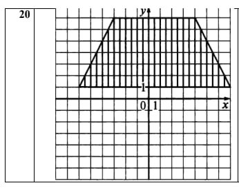
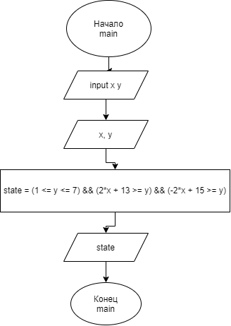

# Домашняя работа №6 (Вариант 20)

## Условие задачи

Составить программу, которая проверяет принадлежит ли заданная пользователем точка с
координатами (х, у) заданным закрашенным (заштрихованным) областям, показанным на рисунках
в табл., и выводит на экран сообщение.



---

## 1. Алгоритм и блок-схема

### Алгоритм

1. Настроить локализацию для корректного вывода русского текста
2. Переменные `x`, `y` типа `double` для хранения координат
3. Запросить у пользователя ввод значений координат `x` и `y`
4. Выполнить проверку попадания в область трапеции:
- По высоте: от `y = 1` до `y = 7`
- По левой границе: `2*x + 13 >= y` (проходит через точки `(-6, 1)` и `(-3, 7)`)
- По правой границе: `-2*x + 15 >= ` (через точки `(7, 1)` и `(4, 7)`)
5. Если все условия выполняются одновременно, то 1, если нет, то 0
6. Вывести результат и завершить программу.

### Блок-схема



---

## 2. Реализация программы
---

## 3. Результаты работы программы
### Контрольный пример 1
```
input x y: -6 1
output: 1
```
### Контрольный пример 2
```
input x y: -6.1 1
output: 0
```
### Контрольный пример 3
```
input x y: 4 7
output: 1
```
### Контрольный пример 4
```
input x y: -5 3
output: 1
```
---

## 4. Информация о разработчике

- **ФИО:** Лавлинский Алексей Евгеньевич
- **Группа:** бОТИ-261, 2п/г
